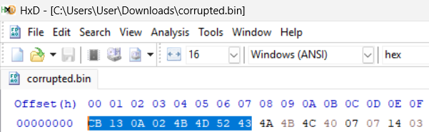

# Ghost in the Radio

| Competition | Category | Solved by |
| --- | --- | --- |
| UMCS CTF 2026 | Crypto | [@Hooiqi](https://github.com/Hooiqi) |

## The Solve

I opened `corrupted.bin` in HxD to check its header. The first eight bytes were:

```text
CB 13 0A 02 4B 4D 52 43
```



The hint said to XOR the first four bytes with the standard PNG magic bytes. A PNG file starts with this [eight-byte signature](https://www.w3.org/TR/png/#5PNG-file-signature):

```text
89 50 4E 47 0D 0A 1A 0A
```

Since XOR reverses itself, XORing the encrypted bytes with the expected plaintext reveals the corresponding key bytes:

```text
CB XOR 89 = 42
13 XOR 50 = 43
0A XOR 4E = 44
02 XOR 47 = 45
```

The key was increasing by one at each position, starting from `0x42`. That suggested a rolling mask rather than one fixed XOR byte. I used this formula, with `i` starting at zero:

```text
key[i] = (0x42 + i) % 256
plaintext[i] = ciphertext[i] XOR key[i]
```

The modulo keeps the mask within one byte, wrapping back to zero after `0xFF`. Applying it to the first 16 bytes shown in HxD gives:

```text
89 50 4E 47 0D 0A 1A 0A 00 00 00 0D 49 48 44 52
```

That restored both the PNG signature and the start of the `IHDR` chunk, which was a useful check that the mask worked beyond the first four bytes.

I applied the same operation to the whole file with Python and saved the result as `signal_recovered.png`. A short version of the decryption loop is:

```python
from pathlib import Path

data = Path("corrupted.bin").read_bytes()
recovered = bytes(
    byte ^ ((0x42 + i) & 0xFF)
    for i, byte in enumerate(data)
)
Path("signal_recovered.png").write_bytes(recovered)
```

Once the file was restored, I opened the PNG and read the flag written in the image.

## Flag

```text
UMCS{XOR_M4G1C_BYT3S}
```

[Back to UMCS CTF](../../README.md)
