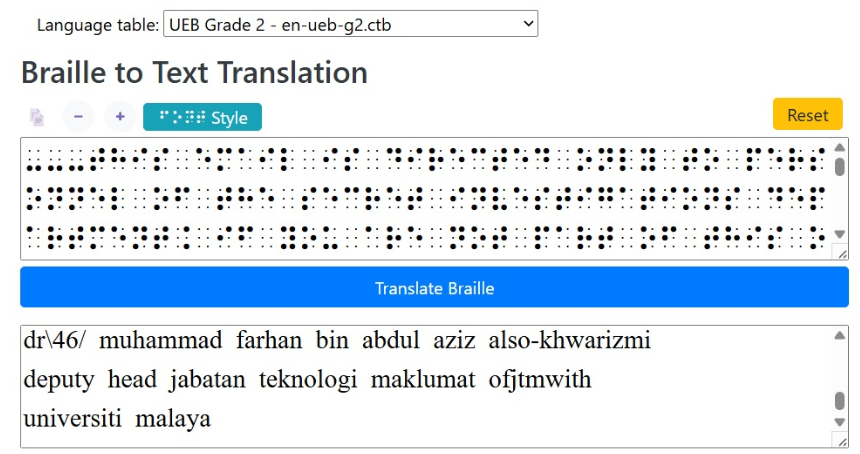

# Makmal Buta, UM

| Competition | Category | Solved by |
| --- | --- | --- |
| UMCS CTF 2026 | Crypto | [@Hooiqi](https://github.com/Hooiqi) |

## The Solve

The question and `output.txt` were written in Braille, so I started by translating both into readable text. `output.txt` contained an email with the agent's instructions and a log archive.



I saved the decoded archive as `arkib_makmal_buta.txt`, matching the filename expected by `loganathan_translated_to_py3.py`. There were **637 log entries**, each with a hexadecimal ID. Seven entries had unusual status messages:

```text
007, 021, 111, 299, 333, 453, 535
```

My initial notes connected several clues to `X = 9`: the cat's nine lives, the square root of Japan's calling code `81`, and the requirement for an odd value. These helped with interpreting the hints, but the log IDs still needed a concrete decoding method.

The important part of the recorded solution was reconstructing Python's Mersenne Twister state. The first 624 IDs were treated as consecutive, unmodified outputs of `random.getrandbits(32)`. Each output had to be converted from hex to an integer and then untempered before being used as a state word. Setting the state directly from the observed output values would not work.

I split the IDs into those first 624 outputs and the 13 remaining entries:

```python
state_outputs = ids[:624]
encrypted_tail = ids[624:]
```

The tail contains 13 entries because `637 - 624 = 13`. The negative-index clue pointed me towards the end of the archive, but a literal `ids[-9:]` would only select nine entries.

A [published solve of the same challenge](https://github.com/hawtdawg1/CTF-Writeups/blob/650be6ab31dde4763f46a6a1f3a791ce21eb5bd0/2026/UMCS_CTF_2026/Makmal%20Buta,%20UM/README.md) describes the final operation as XORing each tail ID with the next predicted 32-bit value. That fills in the missing decoding step from my earlier notes:

```text
decoded_value = encrypted_id XOR predicted_value
```

There is an error in that published script's untempering constants, so it should not be copied unchanged. The forward tempering operations in [CPython's implementation](https://github.com/python/cpython/blob/3.13/Modules/_randommodule.c) are:

```text
value ^= value >> 11
value ^= (value << 7) & 0x9D2C5680
value ^= (value << 15) & 0xEFC60000
value ^= value >> 18
```

To recover the state, those operations need to be reversed in the opposite order. After reconstructing all 624 state words, the clone's index should be set to 624 before predicting the tail values.

The complete log archive and challenge script are still needed to rerun this on the original inputs. In particular, the exact role of `X = 9` has not been verified against that script. The final flag below matches both my solve notes and the published result.

## Flag

```text
UMCS{NMBRXD3}
```

[Back to UMCS CTF](../../README.md)
