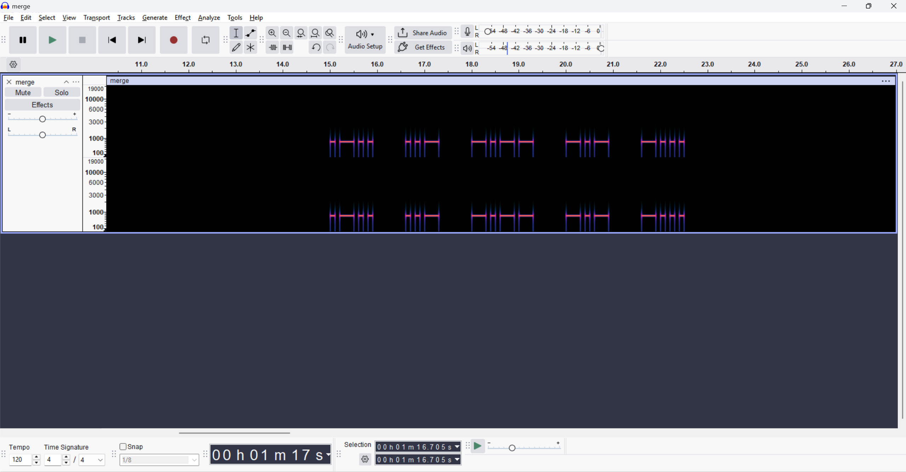
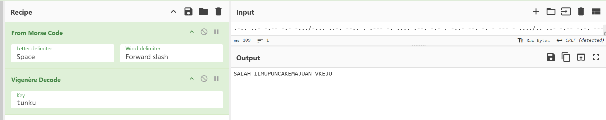

# Phantom Anthem of DTC

| Competition | Category | Solved by |
| --- | --- | --- |
| UMCS CTF 2026 | Crypto | [@adrianchx](https://github.com/adrianchx) |

## The Solve

The challenge started with a WAV file. Listening to it normally, it sounded like a university anthem, although I wasn't sure of the exact song. Nothing obvious stood out in the audio itself.

The hint told me to focus on the properties of sound and what happens when two opposing forces meet. That reminded me of destructive interference from SPM physics: if two matching signals have opposite polarity, adding them together cancels them out.

I opened the file in Audacity and split the stereo audio into two mono tracks. I then inverted one track and mixed the tracks together. This effectively subtracted one channel from the other, removing the parts they had in common.

At first, the result was mostly silence, which made sense because the music was cancelling out. After that, I could hear beeps that sounded like Morse code. I wasn't confident decoding them by ear, so I switched to the spectrogram and read the short and long signals from there.



After transcribing the Morse and decoding it, I got:

```text
LUYKB BFZEJNHPKEXGNTOTH IUYCO
```

This still looked encrypted. I tried dCode's cipher identifier, which suggested a Vigenère cipher. The other hint mentioned the "father of the university," which led me to try the name Tunku Abdul Rahman as the key. The part that worked was simply `TUNKU`.

In CyberChef, I used **From Morse Code** followed by **Vigenère Decode**, with `tunku` as the key. The output was:

```text
SALAH ILMUPUNCAKEMAJUAN VKEJU
```



The middle part read `ILMUPUNCAKEMAJUAN`. Since the flag was supposed to contain three words, I separated it into `ILMU`, `PUNCA`, and `KEMAJUAN`, then added the flag wrapper and underscores.

## Flag

```text
UMCS{ILMU_PUNCA_KEMAJUAN}
```

[Back to UMCS CTF](../../README.md)
