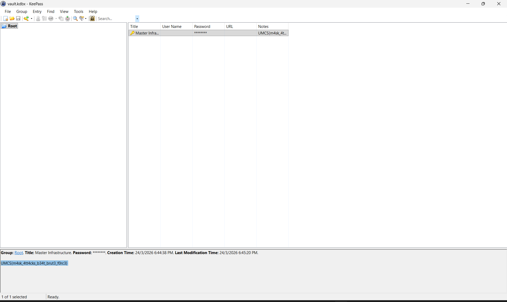

# The Hexed Protocol

| Competition | Category | Solved by |
| --- | --- | --- |
| UMCS CTF 2026 | Crypto | [@Hooiqi](https://github.com/Hooiqi) |

## The Solve

I started with `vault_dump.txt`, a raw hex dump that needed to be turned back into a KeePass database. I loaded it into CyberChef, used **From Hex**, and saved the decoded bytes as `vault.kdbx`.

The vault still needed a password, so I checked `scraps.md` for clues. It described the password format as:

```text
[Core Value] + [4-Digit PIN] + [One Special Character]
```

This gave me a specific format to search instead of trying arbitrary passwords. Each candidate needed a core value, a four-digit PIN, and one special character at the end. The PIN needed to stay four digits long, including any leading zeroes.

A [published transcription of the HR memo](https://github.com/hawtdawg1/CTF-Writeups/blob/650be6ab31dde4763f46a6a1f3a791ce21eb5bd0/2026/UMCS_CTF_2026/The%20Hexed%20Protocol/README.md) lists the core values as `Synergy`, `Disruption`, `Pivot`, `Agility`, and `Paradigm`, with only the first letter capitalized. These details determine which password candidates to test.

I used a Python script with `pykeepass` to test passwords matching that format against `vault.kdbx`. The script kept trying candidates until it found one that could open the database.

Once I had the correct password, I looked through the vault entries. The **Master Infrastructure** entry had the flag in its **Notes** field.



## Flag

```text
UMCS{m4sk_4tt4cks_b34t_brut3_f0rc3}
```

[Back to UMCS CTF](../../README.md)
