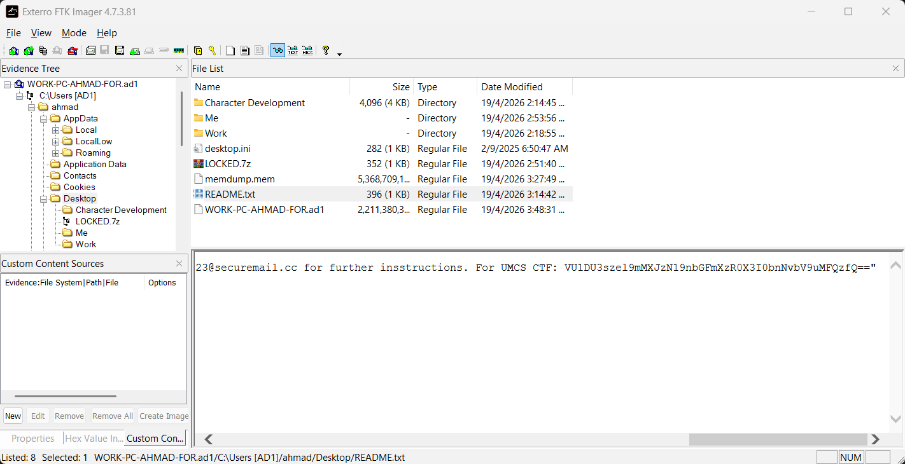
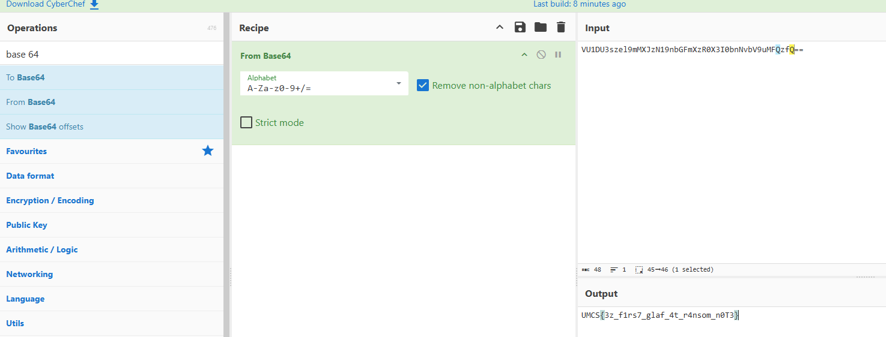

# Metamon1

| Competition | Category | Solved by |
| --- | --- | --- |
| UMCS CTF 2026 | DFIR | [@SelinaTan05](https://github.com/SelinaTan05) |

## The Solve

I downloaded the challenge ZIP and extracted the forensic image using the provided password:

```text
UMCSCTF26!@#
```

The image was named `WORK-PC-AHMAD-FOR.ad1`. I loaded it into FTK Imager through **File → Add Evidence Item → Image File**, which let me browse the captured files from Ahmad's computer.

I checked the user's Desktop for the ransom note:

```text
Users\Ahmad\Desktop\
```

There was a file called `README.txt`. I opened it in FTK Imager's text view and found a Base64 string near the end of the message, after the label `For UMCS CTF:`.



The string was:

```text
VU1DU3szel9mMXJzN19nbGFmXzR0X3I0bnNvbV9uMFQzfQ==
```

I copied it into CyberChef and applied **From Base64**. It decoded directly to the flag, so there was no need to recover the encrypted files for this part of the challenge.



## Flag

```text
UMCS{3z_f1rs7_glaf_4t_r4nsom_n0T3}
```

[Next: Metamon2](../Metamon2/README.md) · [Back to UMCS CTF](../../README.md)
