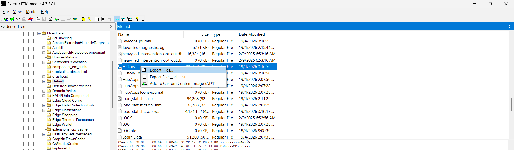

# Metamon2

| Competition | Category | Solved by |
| --- | --- | --- |
| UMCS CTF 2026 | DFIR | [@SelinaTan05](https://github.com/SelinaTan05) |

## The Solve

After finding the ransom note in Metamon1, I checked the browser history to work out what the user had visited around the incident. The browser artifacts were under Microsoft Edge's user data directory:

```text
Users\Ahmad\AppData\Local\Microsoft\Edge\User Data\
```

I looked for the file named `History`, which is the browser history database. The usual profile location to check is `User Data\Default\`, but in this image I found the selected file directly in the `User Data` listing.

I right-clicked `History` and selected **Export Files** to save a copy for analysis.



I inspected the exported history with a browser-history viewer and focused on records from **19 April 2026**, the date of the incident. I was looking for unusual visits that could explain what happened before the ransom note was found.

One record stood out: a page titled **reCAPTCHA Verification** on `pinarat.github.io`, with the path `/a/`. That was the suspicious page identified during the solve.

The URL used for the final answer was `https://pinarat.github.io/a/`, including the trailing slash.

## Flag

```text
UMCS{https://pinarat.github.io/a/}
```

[Previous: Metamon1](../Metamon1/README.md) · [Next: Metamon3](../Metamon3/README.md) · [Back to UMCS CTF](../../README.md)
