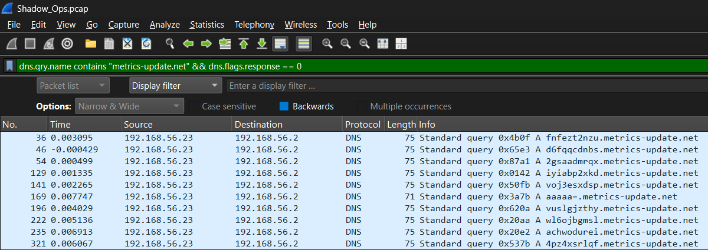
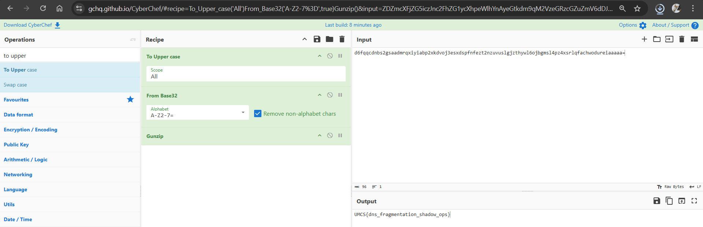

# Shadow Ops

| Competition | Category | Solved by |
| --- | --- | --- |
| UMCS CTF 2026 | Forensics | [@SelinaTan05](https://github.com/SelinaTan05) |

## The Solve

I opened `Shadow_Ops.pcap` in Wireshark and started looking through the traffic. There were normal-looking websites and some Base64 messages, but decoding those messages only gave me decoys such as "not the real flag."

The DNS requests to `metrics-update.net` stood out. Their subdomains looked like encoded fragments, and ordering this group by timestamp gave me a sequence to work with. I filtered for queries to that domain:

```wireshark
dns.qry.name contains "metrics-update.net" && dns.flags.response == 0
```

Using `dns.flags.response == 0` kept the requests, so I would not accidentally include the same fragment again from a DNS response.



I sorted the matching requests by increasing timestamp, then took the part before `.metrics-update.net` from each query. Packet number order was not the same as timestamp order in the screenshot, so simply reading down the original packet list would not reconstruct the message correctly.

After joining the subdomains in chronological order, I had this string:

```text
d6fqqcdnbs2gsaadmrqxiyiabp2xkdvoj3esxdspfnfezt2nzuvuslgjzthywl6ojbgmsl4pz4xsrlqfachwodureiaaaaa=
```

I pasted it into CyberChef and used this recipe:

```text
To Upper case
From Base32
Gunzip
```

The captured subdomains were lowercase, so I converted the string to uppercase for the standard Base32 alphabet. Base32 decoding turned it back into binary data, and Gunzip unpacked the compressed message. The output was the flag.



## Flag

```text
UMCS{dns_fragmentation_shadow_ops}
```

[Back to UMCS CTF](../../README.md)
