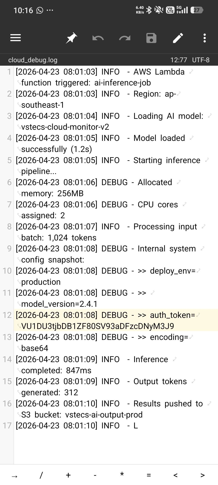
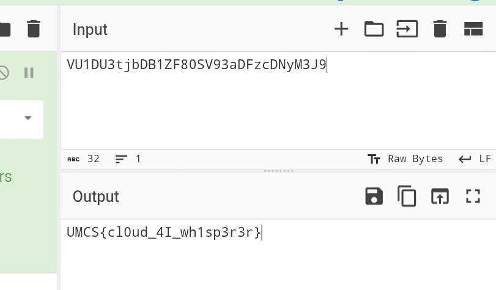

# Cloud Whisperer

| Competition | Category | Solved by |
| --- | --- | --- |
| UMCS CTF 2026 | Misc (working classification) | [@adrianchx](https://github.com/adrianchx) |

## The Solve

The challenge gave me a file called `cloud_debug.log`, so I opened it and looked through the log messages. Most of the lines were about an AWS Lambda job loading an AI model and running inference, but one line contained an `auth_token`:

```text
auth_token=VU1DU3tjbDB1ZF80SV93aDFzcDNyM3J9
```

The next line said `encoding=base64`, which made it clear what to do with the string.



I copied the token into CyberChef and used **From Base64**. The output was already in the `UMCS{...}` flag format, so that was all I needed to solve the challenge.



## Flag

```text
UMCS{cl0ud_4I_wh1sp3r3r}
```

[Back to UMCS CTF](../../README.md)
