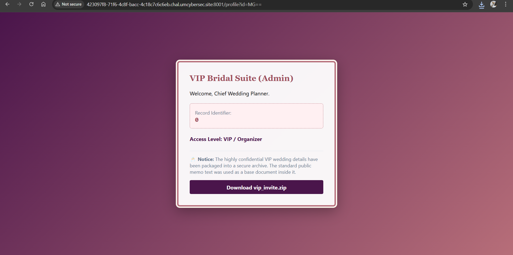
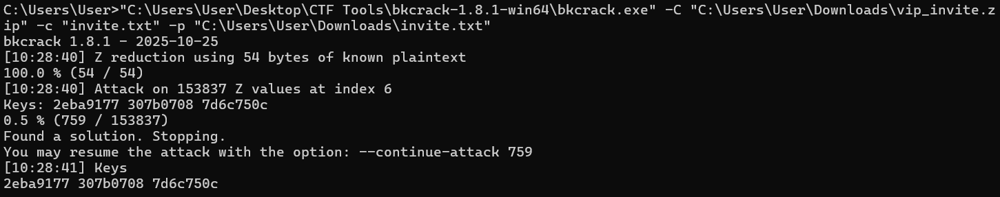
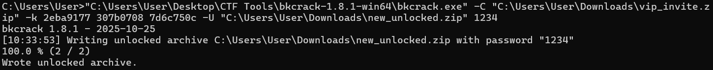

# I-DO The Veiled Vow

| Competition | Category | Solved by |
| --- | --- | --- |
| UMCS CTF 2026 | Web | [@SelinaTan05](https://github.com/SelinaTan05) |

## The Solve

The profile page had an `id` parameter in the URL:

```text
/profile?id=Mg==
```

`Mg==` is the Base64 encoding of `2`. I changed it to `MA==`, which decodes to `0`, to see whether I could access the admin profile:

```text
/profile?id=MA==
```

This worked. The page changed to **VIP Bridal Suite (Admin)** and showed record identifier `0`, with the access level **VIP / Organizer**. Changing the ID was enough to access the admin record, so this was an IDOR issue.



The admin page had a download for `vip_invite.zip`. It also mentioned that the public memo had been used as a base document inside the archive. I downloaded both the ZIP and the public `invite.txt`.

Since I had the public invitation and an encrypted copy inside the ZIP, I used `bkcrack` to try a known-plaintext attack. With both files in the same directory, I ran:

```console
bkcrack -C vip_invite.zip -c invite.txt -p invite.txt
```

The attack used 54 bytes of known plaintext and recovered these three internal keys:

```text
2eba9177 307b0708 7d6c750c
```



The known plaintext has to match the encrypted entry's bytes. If recreating the public memo rather than using the downloaded file, line endings and a trailing newline can affect the attack.

With the keys recovered, I could create a copy of the archive with a password of my choice. I used `1234` for the new archive:

```console
bkcrack -C vip_invite.zip -k 2eba9177 307b0708 7d6c750c -U new_unlocked.zip 1234
```



`1234` was the password I set for `new_unlocked.zip`; I did not need to recover the original ZIP password. I opened the new archive using `1234` and read `flag.txt` to get the flag.

## Flag

```text
UMCS{00849a10-79f0-4794-a95b-b3ab6819459c}
```

[Back to UMCS CTF](../../README.md)
